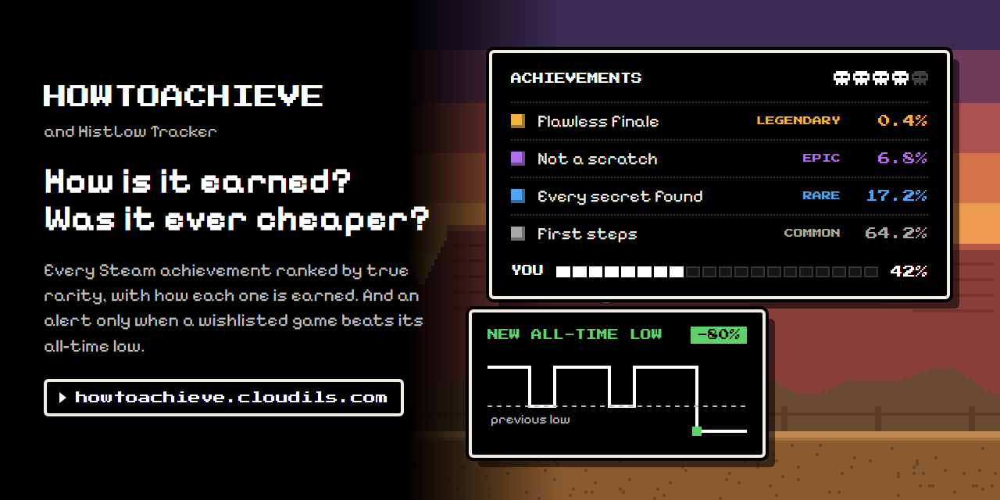
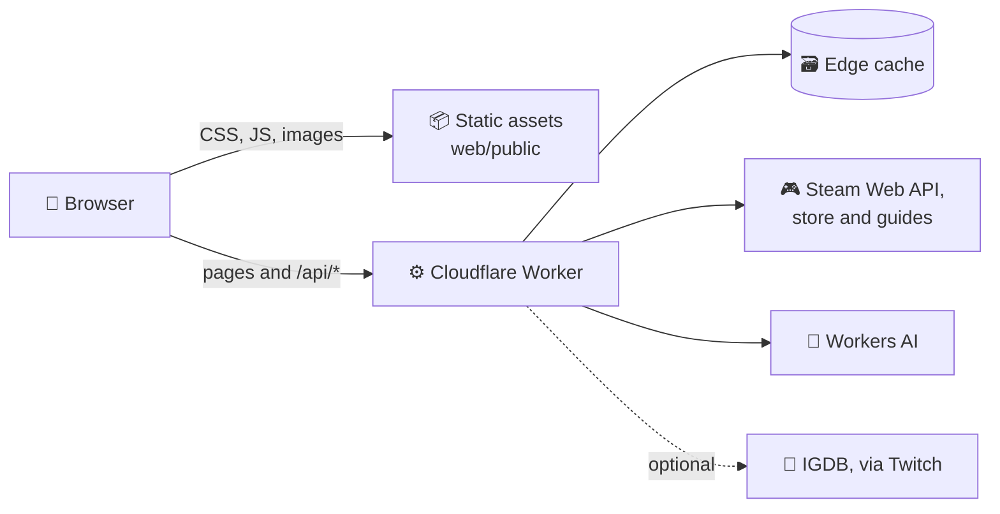
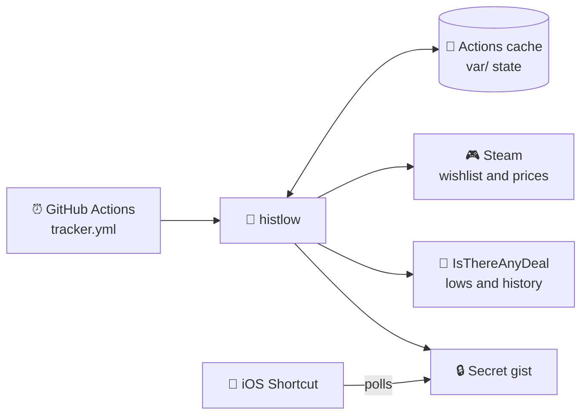

<p align="center">
  
</p>

<p align="center">
  <a href="https://github.com/Isma-L154/histlow-tracker/actions/workflows/ci.yml"></a>
  <a href="https://github.com/Isma-L154/histlow-tracker/actions/workflows/deploy-web.yml"></a>
  
  
  <a href="LICENSE"></a>
</p>

<p align="center">
  <b>Two small Steam tools that share nothing but this repository.</b><br>
  HowToAchieve shows how every achievement in a game is earned, rarest first.<br>
  HistLow Tracker speaks up only when a wishlisted game beats its all-time low.
</p>

<p align="center">
  <a href="https://howtoachieve.cloudils.com">Live site</a> ·
  <a href="https://github.com/Isma-L154/histlow-tracker/issues">Report a bug</a> ·
  <a href="docs/SETUP.md">Set up the tracker</a>
</p>

---

# HowToAchieve

**[howtoachieve.cloudils.com](https://howtoachieve.cloudils.com)** · a Cloudflare Worker in [`web/`](web/)

## What it does

- **Ranked by true rarity** — every achievement, rarest first, by Steam's global unlock percentage,
  grouped into five loot tiers: legendary (held by under 5%), epic, rare, uncommon and common.
- **How each one is earned** — community guides summarised into steps, every source linked. When the
  daily AI allowance runs out, the guide passages themselves are the answer.
- **Difficulty 1–10 and time to 100%** — the score comes from the rarity distribution; the time from
  IGDB, and is simply absent without IGDB credentials.
- **What you are missing** — paste a Steam profile and the list splits into held and missing, with your
  progress and the rarest achievement you hold.
- **A pixel-art home page** — a party of tribute heroes walks through five rotating worlds, drawn in a
  canvas by code; it stays still when the system asks for reduced motion.
- **English content, interface in English or Spanish** — translated on the server, so the first paint
  is already in your language.

## How it works



Static files never reach the Worker; every document does, so it can translate the page and give each
game its own link preview. Every external call is cached at the edge and **degrades to absence, never
to an error**. `src/index.ts` must export only its default handler: a named export breaks the Worker at
startup, and `wrangler deploy --dry-run` does not catch it.

**Stack:** Cloudflare Workers · TypeScript · Workers AI · plain HTML, CSS and JavaScript, no build step ·
Vitest in workerd

## Running locally

Needs Node.js 22. `npm run dev` also needs a Cloudflare login, because Workers AI has no local
simulator; the tests need neither a login nor a network.

```bash
cd web
npm ci
npx wrangler types   # generates the binding types from wrangler.jsonc
npm run dev          # http://localhost:8787, reads web/.dev.vars
npm test             # the suite, inside workerd
npm run check        # binding types, typecheck and a deploy dry run
```

`web/.dev.vars`, one `NAME=value` per line:

| Variable | Description |
| -------- | ----------- |
| `STEAM_WEB_API_KEY` | Required. From [steamcommunity.com/dev/apikey](https://steamcommunity.com/dev/apikey); without it every Steam route answers 503. |
| `TWITCH_CLIENT_ID`, `TWITCH_CLIENT_SECRET` | Optional, for IGDB. A free app at [dev.twitch.tv/console/apps](https://dev.twitch.tv/console/apps). |

> ⚠️ `.dev.vars` is git-ignored and must never be committed. Everything non-secret is in
> [`web/wrangler.jsonc`](web/wrangler.jsonc), commented.

## Deployment

A push to `main` that touches `web/` deploys it through
[`deploy-web.yml`](.github/workflows/deploy-web.yml), which then checks production: health, security
headers, `HEAD` against `GET`, and the old address's redirect. Never deploy by hand.

- Repository secrets: `CLOUDFLARE_API_TOKEN`, and `CLOUDFLARE_ACCOUNT_ID` if the token reaches more than
  one account.
- Worker secrets, once, from `web/`: `npx wrangler secret put STEAM_WEB_API_KEY` (and the two Twitch
  values, optionally).

## Security

- **Secrets stay on the server** as Worker secrets; `logFailure` redacts every query value not on its
  allowlist.
- **Bounded input** — ids, achievement keys and searches are checked before Steam is called.
- **Rate limits per IP** on the routes that spend a budget: 20 a minute for how-to answers, 10 for
  profile lookups, completion times and personal lists.
- **Strict CSP** in [`web/public/_headers`](web/public/_headers) (`default-src 'none'`, no inline code),
  plus HSTS, `nosniff` and `no-referrer`, copied onto every Worker response.
- **Same-origin, no database** — no CORS headers, and personal lists bypass the cache.

---

# HistLow Tracker

A Python cron job in [`src/histlow/`](src/histlow/) that alerts only when a sale **beats** a game's
all-time Steam low — a new record, not a return to an old one.

## What it does

- **New records only** — set `alerts.require_new_record` to `false` in [`config.json`](config.json) to
  hear about returns to the old low too.
- **Prices in your currency**, decided in a region IsThereAnyDeal tracks.
- **One notification per deal, no app to install** — an iOS Shortcut polls a secret gist and remembers
  the last `alert_id` it showed.
- **Runs itself** — a GitHub Actions cron that fires twice a day, standard library only.

## How it works



Each run takes the wishlist, keeps the discounted games, keeps those at or below their all-time Steam
low, keeps those whose sale set that low, drops anything already alerted, and publishes the rest.
Layering is one-directional: `domain` depends on nothing, and only `pipeline` wires the adapters
together.

**Stack:** Python 3.11+, standard library only · GitHub Actions · IsThereAnyDeal API · GitHub Gists ·
iOS Shortcuts

## Running locally

Needs Python 3.11 or newer.

```bash
python -m venv .venv && . .venv/bin/activate   # .venv\Scripts\activate on Windows
python -m pip install -e ".[dev]"              # required: src/ layout, plus pytest and ruff
python -m pytest
python -m ruff check .
cp .env.example .env                           # then fill it in
python -m histlow --dry-run --force            # a full run that publishes nothing
```

| Variable | Description |
| -------- | ----------- |
| `STEAM_ID64` | Required. Your 17-digit id; the wishlist must be public. |
| `ITAD_API_KEY` | Required. The API key of an app at [isthereanydeal.com/apps/my](https://isthereanydeal.com/apps/my/), not the OAuth values. |
| `GIST_ID` | The secret gist to publish to, created by [`scripts/bootstrap_gist.py`](scripts/bootstrap_gist.py). |
| `GIST_TOKEN` | A GitHub token with the `gist` scope only. |
| `STORE_COUNTRY` | The storefront you buy from, as a 2-letter code. |
| `COMPARISON_COUNTRY` | Where the decision is made, since ITAD lacks some currencies. Defaults to `US`. |
| `LOG_LEVEL` | Optional, `INFO` by default. Secrets are masked at every level. |
| `DRY_RUN` | Optional. `true` publishes nothing. |

> ⚠️ `.env` is git-ignored and must never be committed.

## Deployment

Nothing to host: [`tracker.yml`](.github/workflows/tracker.yml) runs it and keeps its state in the
Actions cache. Set the secrets `STEAM_ID64`, `ITAD_API_KEY`, `GIST_ID` and `GIST_TOKEN`, and optionally
the variables `STORE_COUNTRY` (default `CR`) and `COMPARISON_COUNTRY` (default `US`). The full first-time
setup, iOS Shortcut included, is in [`docs/SETUP.md`](docs/SETUP.md).
[`keepalive.yml`](.github/workflows/keepalive.yml) stops GitHub disabling the cron after 60 quiet days.

## Security

- **Secrets only in the environment**, masked in every log line.
- **Least privilege** — `GIST_TOKEN` can only touch gists, every workflow declares its `permissions`,
  and actions are pinned by SHA.
- **Validated before any request** — a bad Steam id, country code or `config.json` stops the run with
  exit code 1.
- **No server surface**, so CORS, rate limiting, RLS and CSP do not apply.

---

## Licence

[MIT](LICENSE). Achievement data, artwork and guide text belong to Steam and the players who wrote them;
nothing is stored, only fetched, briefly cached and attributed. The home page's characters and worlds
are original pixel art drawn as a tribute to the games they evoke, not official material; the
[Terms](https://howtoachieve.cloudils.com/terms) say so and how to ask for their removal. The site uses
Press Start 2P and Pixelify Sans, self-hosted under the SIL Open Font License 1.1
([licences](web/public/fonts/)), and so does the banner over a frame of the home page's
desert; regenerate it from [`docs/brand/banner.html`](docs/brand/banner.html), which carries
the command.
